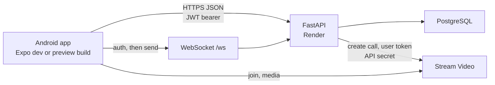

# Technical decisions

LandConnect is a prototype. The notes below match the code in `backend/` and `mobile/`.

## Architecture



The app owns the screens, the session in Secure Store, and the Stream client after the server issues a token. FastAPI owns accounts, listings, messages, blocks, call logs, and meeting membership. PostgreSQL stores that data, including image bytes. Stream owns the media session. The app never creates a call. `CallService` does, with the API secret. Chat is a separate WebSocket on the same API process. It is an in-memory map of sockets, so it is correct for one server process.

## Code structure

```
render.yaml              # Render blueprint; rootDir is backend
backend/
  app/
    main.py              # routers and GET /health; creates tables on startup
    config.py            # env: database URL, JWT secret, Stream keys
    db.py                # engine, sessions, create_all, call_privacy column add
    deps.py              # bearer JWT and require_role
    seed.py              # demo users and Bengaluru listings
    models/              # User, Listing, StoredImage, Conversation, Message, Block, CallLog, Meeting
    schemas/             # Pydantic inputs and outputs, including PublicUser
    routers/             # auth, users, listings, images, conversations, blocks, calls, meetings, ws
    services/
      auth_service.py    # bcrypt and JWT
      storage.py         # resize and store listing images
      chat_service.py    # conversations, phone masking, blocks
      call_service.py    # the only module that talks to Stream
  tests/                 # pytest
  requirements.txt
  .env.example

mobile/
  app.json               # Android only, WebRTC and location plugins
  eas.json               # development and preview APKs, EXPO_PUBLIC_API_URL
  index.tsx              # Expo root
  src/
    app/
      _layout.tsx        # auth gate, QueryClient, CallProvider
      (auth)/            # login, register, role picker
      (tabs)/            # community, map, chats, meetings, profile
      listing/[id].tsx   # detail, map pin, contact bar
      listing-form.tsx   # create and edit, sellers and brokers only
      my-listings.tsx
      chat/[id].tsx
      meeting-new.tsx
    api/                 # axios client, auth, listings, chat, meetings
    calls/               # Stream client, incoming, outgoing, in-call, meeting join
    chat/useChatSocket.ts
    listings/            # cards, filters, form, image picker
    map/                 # Leaflet HTML, browse map, location picker, mini map
    store/auth.ts        # Zustand session
    theme/               # colors, Screen, Header
```

`render.yaml` is at `landconnect/render.yaml`, with `rootDir: backend`. `src/calls/CallDialer.tsx` is the early dial-by-user-id screen. No route mounts it. Calls in the product go through the listing contact bar and the chat header.

## Technical decisions

| Area | Choice | Why | Alternatives considered |
| --- | --- | --- | --- |
| Mobile runtime | Expo development build, Android APK via EAS | Stream's React Native SDK needs WebRTC native code. Expo Go cannot load it. | Expo Go. A bare React Native app with no Expo. |
| API | FastAPI | Small Python service, typed request bodies, `pytest` against `TestClient`, WebSocket support in the same app. | Django. A Node API. |
| Database | PostgreSQL | Listings, chat, call logs, and image bytes need one transactional store. SQLAlchemy talks to it. | SQLite in production. A document database. |
| Auth | JWT access token, 7 days, bcrypt passwords | Stateless checks on HTTP and on the WebSocket. The token is the user id plus expiry. | Server sessions. A third-party auth provider. |
| Calls | Stream Video behind `CallService` | Media, ringing, and device handling stay in Stream. The rest of the API only sees call logs and errors. | Raw WebRTC signaling in FastAPI. Another CPaaS called from the phone. |
| Chat | Our own WebSocket | Messages must be stored, authorized, and masked before anyone else sees them. A vendor inbox would bypass that. | Stream Chat. Polling `GET` messages. |
| Maps | Leaflet and OpenStreetMap in a WebView | No map API key. Browse, pick, and view modes share one HTML map. | Google Maps. `react-native-maps`. |
| Images | Bytes in Postgres (`stored_images`) | One database, no object-storage account. Uploads are resized to 1600px JPEG before insert. | S3 or Cloudinary. Files on the Render disk. |
| Server data on the phone | TanStack Query | Listings, meetings, profile, blocks, and call history share cache, refresh, and pagination. | Fetching in each screen with `useEffect` only. |
| Deploy | Render web service plus a hosted Postgres URL | `render.yaml` builds and starts the API. The phones use a public HTTPS URL, which two physical devices can both reach. | A laptop on the LAN. A PaaS that cannot host a long-lived WebSocket. |

## Calling design

1. After login, `CallProvider` calls `POST /calls/token`. The server upserts the Stream user and returns the API key, the Stream user id (the same integer as the LandConnect user id), and a token that lasts 24 hours. The phone builds a `StreamVideoClient` and refreshes the token the same way.
2. The caller taps Audio or Video on a listing or in a chat. The phone asks for microphone permission, and camera permission for video. It then calls `POST /calls/start` with `callee_id` and `type`.
3. `CallService.start_call` rejects a self-call, an unknown user, a block in either direction (`403 blocked`), and a callee whose `call_privacy` is `contacts` when the two users have no conversation (`403 not accepting calls`). Otherwise it creates a Stream call of type `default` with `ring: true`, both users as members, and `custom.video` / `custom.logged: true`. It stores a `CallLog` in status `ringing` and returns `call_id`.
4. The caller loads that call with `call.get()`, enables the mic (and camera for video), and joins. Stream rings the callee because the server set `ring: true`. The callee's app must already be open and connected to Stream. `IncomingCall` shows Accept and Reject.
5. Accept joins the call, then `POST /calls/{call_id}/status` with `accepted`. Reject reports `rejected` and leaves with `reject: true`. Cancel on the outgoing screen reports `missed`. End reports `ended` if the other person had joined, otherwise `missed`, then ends or leaves the Stream call. Only the caller and callee can update the log. A finished status is not overwritten.
6. Meetings are separate. `POST /meetings` stores a row, adds the host and invitees, and sets `call_id` to `meeting-` plus a random id. It does not open Stream yet. `POST /meetings/{id}/join` checks membership, creates the Stream call with `ring: false` and `custom.logged: false`, and returns a token. The phone joins as video. Those calls are not written to `call_logs`, because `reportLoggedStatus` skips `logged: false`.

Call creation is server-mediated so a client token cannot start a ring. Block and call-privacy checks run before Stream is contacted. The Stream dashboard removes `CreateCall` from the `user` role. The API secret used in `CallService` is what is allowed to create the call.

## Privacy and access control

Roles are `buyer`, `seller`, and `broker`. Registration rejects any other role. `require_role` limits listing create, update, delete, and image upload to sellers and brokers. The mobile stack hides the listing form unless `canList` is true. Editing and deleting also check `owner_id`.

`PublicUser` is `id`, `name`, and `role`. Listing owners, chat partners, call history, blocks, and meeting participants use that schema. `Me` adds `email` and `call_privacy`, and only `GET /me` and `PATCH /me` return it. There is no phone column. Password hashes stay on the user row.

`GET /listings`, `GET /listings/{id}`, and `GET /images/{id}` are public. Everything else needs a valid JWT, except `POST /auth/register` and `POST /auth/login`. The WebSocket accepts the first message as `{type: "auth", token}` within 10 seconds, then closes with 1008.

A block is one row, `(blocker_id, blocked_id)`. `is_blocked` is true in either direction. That blocks a new conversation, a WebSocket send, `POST /calls/start`, and a meeting invite. Unblock is `DELETE /blocks/{user_id}`.

`call_privacy` defaults to `everyone`. `contacts` allows a call only when some conversation already exists between the two users. It does not have to be for the same listing.

Chat reads and sends use `participant_conversation`. A non-member gets 404. Messages are unique on `(conversation_id, client_id)`, so a reconnect that resends the same id does not insert a second row. `mask_phone_numbers` rewrites digit runs of length 10 or more before insert.

## Implementation approach

The repo was built in this order. The commit messages are the step names.

1. Scaffold the FastAPI app and the Expo app.
2. Split the API into models, schemas, routers, and services. Add `/me`, `PublicUser`, `call_privacy`, and `require_role`.
3. Calling spike. Prove a development build, a Stream token, and a ringing call before the marketplace exists. `CallDialer` is what is left of that screen.
4. Listing management, then the Leaflet map.
5. Chat on the server, then the chat UI and meetings.
6. Privacy and access checks across routes, plus the Render startup fix.

The spike came first because a failed native build or a failed Stream call would block every later demo. Listings and chat could wait. Once `CallService` and `src/calls` worked, the contact bar and chat header called the same `placeCall` function.

## Challenges and solutions

| Challenge | What went wrong | What the code does |
| --- | --- | --- |
| Native WebRTC needs a dev build | Expo Go has no WebRTC native module, so calls cannot load there. | `expo-dev-client`, the Stream and WebRTC config plugins, and EAS profiles that emit an Android APK. `npm start` uses `--dev-client`. |
| Two phones need a reachable backend | `localhost` on a laptop is not visible to a phone, and the phones are not on a shared process. | The API listens on `0.0.0.0` locally and is deployed at a public HTTPS URL. Both APKs use that URL. |
| EAS builds ignore `.env` | A cloud build never sees `mobile/.env`, so the API URL would be missing. | `eas.json` sets `EXPO_PUBLIC_API_URL` on the `development` and `preview` profiles. Local Metro still reads `.env`. |
| Free-tier cold starts | A free Render web service sleeps. The first request, including the WebSocket and `/calls/token`, can fail or hang. | Warm `GET /health` about a minute before a demo. The phone shows the axios error when the host is down. |
| Chat reconnects and duplicate sends | The socket drops. The client retries pending messages and would insert them twice. | The client reconnects with backoff, capped at 30 seconds, and resends with the same `client_id` after `auth_ok`. The server returns the existing row and skips the broadcast when that id was already stored. |
| Privacy bypass via direct client calls | A Stream user token could call `getOrCreate` and ring someone the API would have blocked. | Dashboard: `user` cannot `CreateCall`. Only `CallService`, using the API secret, creates ringing calls and meeting rooms, after the block and privacy checks. |

## Testing

`pytest` in `backend` uses `TEST_DATABASE_URL` or a temporary SQLite file. Each test drops the schema. Stream network calls are patched. Coverage is the rules, not the media path:

- Auth: register, login, duplicate email, password length, no admin role, token expiry of 7 days.
- Users: `/me`, call privacy updates, public profile shape.
- Roles and ownership: a buyer cannot create a listing. Another seller or broker cannot edit or delete it.
- Listings: search, price, land type, bbox, paging, image upload and rejection.
- Chat: create conversation, WebSocket auth, broadcast, paging, duplicate `client_id`, non-participant.
- Blocks: messages, calls, and meeting invites fail both ways. Phone numbers are masked.
- Calls: token auth, 502 when Stream fails, block, `contacts` privacy, participant-only status updates, meeting open with `ring: false`.
- A schema walk checks that response models other than `Me` do not expose email, phone, or password hash. A route walk checks that non-public HTTP routes depend on the current user.

The manual test is two Android phones on the preview APK, scripted in `DEMO.md`. That is what shows ringing, audio, video, and permissions. Pytest never opens a real Stream call.

## Known limitations and future work

- Incoming calls arrive only while the app is open and the Stream client is connected. There is no push notification and no killed-state ring.
- Chat and calls are not end-to-end encrypted. Messages sit in Postgres. Media is Stream's transport.
- The demo is Android only. `app.json` lists a single platform.
- There are no refresh tokens. The access token lasts 7 days. A 401 clears the session.
- Anyone can register as a broker. Nothing verifies a brokerage. The role only gates listing writes.
- Listing images live in the database as bytea. That will not fit a large catalog, and `GET /images/{id}` is unauthenticated.
- The API is a free-tier Render service: one process, cold starts, and the WebSocket connection table is not shared across instances.
- Call history is a log of what the clients reported. It is not a recording, and a crashed client can leave a row in `ringing`.
- `CallDialer` is unused. There is no in-app dial pad in the navigation tree.
